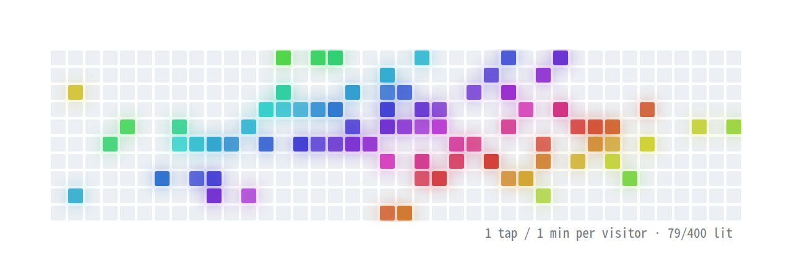
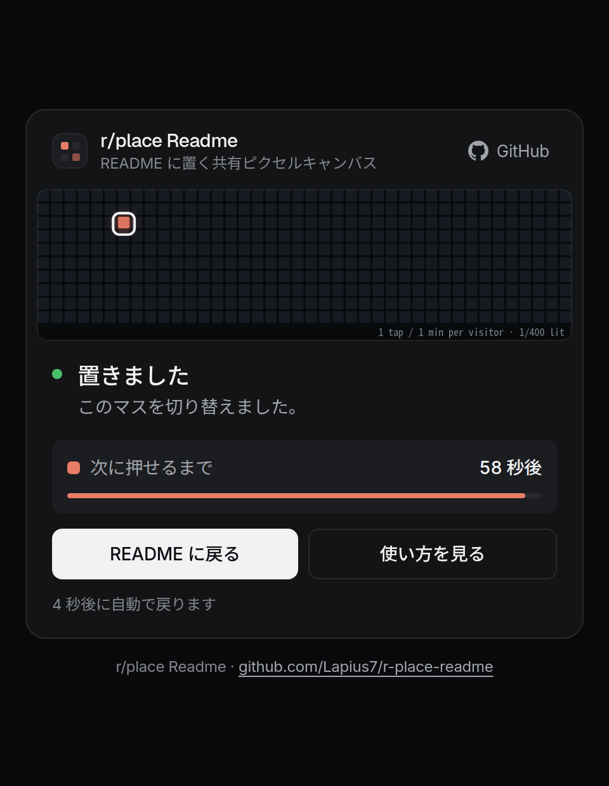

[English](README.md) | 日本語

# r/place Readme

README に置ける共有ピクセルキャンバスです。画像の中のマスをクリックすると、そのマスが点いたり消えたりします。盤面は訪れた全員で共有されます。

<p align="center">
  <picture>
    <source media="(prefers-color-scheme: dark)" srcset="docs/images/board-dark.png">
    
  </picture>
</p>

<p align="center"><sub>見本のデータです。実際の盤面は空の状態から始まります。</sub></p>

公開先: https://r-place-readme.wks.lapius7.com

Cloudflare Worker で動き、盤面は Durable Object(SQLite)に保存します。クライアントのスクリプトはありません。`<a>` が1つ、`` が1つ、その両方に応えるサーバーだけで成り立っています。

## 目次

- [使い方](#使い方)
- [URL 一覧](#url-一覧)
- [マスの細かさ](#マスの細かさ)
- [押したあとの画面](#押したあとの画面)
- [しくみ](#しくみ)
- [プライバシー](#プライバシー)
- [制限事項](#制限事項)
- [自分でホストする](#自分でホストする)
- [設定](#設定)
- [参考にしたもの](#参考にしたもの)

## 使い方

次を README に貼ります。`your-github-username` は、必ず自分の GitHub のユーザー名に置き換えてください。それ以外の名前は使わないでください。

```html
<a href="https://r-place-readme.wks.lapius7.com/board/your-github-username/40/press">
  <picture>
    <source media="(prefers-color-scheme: dark)" srcset="https://r-place-readme.wks.lapius7.com/board/your-github-username/40.svg?mode=dark">
    
  </picture>
</a>
```

次の3点が崩れると、クリックした位置と別のマスが反応します。

- `` に `ismap` を付けます。これでブラウザがクリック位置をリンクに付けて開きます。
- `width="560"` を指定し、`height` は付けません。画像はちょうど 560px 用に描いています。
- 列数(上の例では `40`)は、画像の URL とリンクの URL で同じ値にします。

盤面は、最初に誰かが押した時点で作られます。ユーザー名の大文字は小文字に直され、`[a-z0-9][a-z0-9-]{0,38}` に合う必要があります。

## URL 一覧

| URL | 返すもの |
| --- | --- |
| `/` | このリポジトリへの 302 リダイレクト |
| `/board/<name>.svg` | 標準の細かさの盤面(SVG) |
| `/board/<name>/<cols>.svg` | `<cols>` 列の盤面 |
| `/board/<name>/<cols>/press?x,y` | クリック位置のマスを切り替え、結果の画面を表示 |
| `?mode=light` / `?mode=dark` | SVG のテーマ(既定は `light`) |

これ以外の URL は、このリポジトリへのボタンがついたエラー画面になります。

## マスの細かさ

`<cols>` で列数を決めます。画像の大きさは常に 560 × 140px なので、マスは正方形のまま、行数は列数から決まります。

| 項目 | 値 |
| --- | --- |
| 指定できる値 | 8 から 96 までの 4 の倍数 |
| 既定(`<cols>` を省略) | 40 |
| 行数 | `cols / 4` |
| 40 列のとき | 1マス 14px 刻み、10 行 |

細かさは、クエリではなく URL のパスに入れます。`ismap` のリンクをたどるとき、ブラウザがクエリ全体をクリック位置(`?x,y`)に置き換えてしまうためです。

## 押したあとの画面

マスを押すと結果の画面が開きます。押したマスに輪がついた盤面、押した分が数えられたかどうか、押した本人の次に押せるまでの時間が出ます。約6秒後に README へ戻ります。

<p align="center">
  
</p>

## しくみ

- クリック位置: `<a>` の中の `` をクリックすると、ブラウザは `?x,y` を付けてリンクを開きます。値は画像の左上を原点にした表示上の CSS ピクセルです。サーバーはこれをマスの大きさで割ってマスを決めます。
- 本物のクリックだけを数える: `/press` は、`?x,y` と `Sec-Fetch-Mode: navigate`、`Sec-Fetch-Dest: document` がそろったときだけ数えます。画像として埋め込んだり、スクリプトから呼んだりしても何も起きません。
- 結果を画面で見せる理由: GitHub は README の画像を camo というプロキシ経由で配信するため、画像のリクエストには訪問者の IP が付きません。押したときのリクエストはブラウザから直接届きます。そのため、待ち時間の案内は画像ではなく画面で出します。
- グロー: 点いたマスを `<use>` で2回描きます。1回目には `feGaussianBlur` のフィルターをかけます。マスの明滅は SMIL の `<animate>` です。どれも `` の中で動きます。
- 色: 訪問者の識別値に塩を加えた SHA-256 から色相を決めます。同じ人はいつも同じ色になります。
- クールダウン: 1人あたり60秒に1回です。その間だけ、ハッシュと時刻の行を保存します。
- 保存先: 盤面ごとに Durable Object を1つ使い、SQLite のテーブル `cells`、`taps`、`meta` に保存します。
- キャッシュ: 画像は `no-cache` で返すので、再読み込みすると最新の盤面になります。

## プライバシー

訪問者の識別値はクライアントの IP です。IPv6 は /64 でまとめます。盤面ごとに保存するランダムな塩を加えてハッシュにし、ハッシュだけを、クールダウンが終わるまで保存します。IP アドレスそのものは保存しません。

## 制限事項

- 560px: 画像はちょうど 560px で表示される必要があります。狭いウィンドウやスマートフォンでは GitHub が README の画像を縮めるため、クリックが別のマスに当たります。
- 盤面の名前は公開で、認証がありません: 盤面の名前を知っていれば、別の README からでも押せます。制限するには、推測されにくいパスを使う、名前の許可リストを置く、盤面ごとに回数を制限する、といった方法があります。どれも組み込んでいません。
- `demo` 盤面は共有です: 公開されていて、誰でも変えられます。
- クールダウンは識別値ごとです: 同じ IP(IPv6 では /64)の人は、待ち時間を共有します。

## 自分でホストする

Cloudflare のアカウントと `pnpm` が必要です。

```bash
pnpm install
pnpm typecheck
pnpm dev        # ローカル
pnpm deploy     # wrangler deploy
```

先に `wrangler.jsonc` を編集します。`routes` を自分のドメインに、`vars` を自分のリンクに変えてください。Durable Object のクラス `Canvas` は、マイグレーション `v1` で作られます。

## 設定

`wrangler.jsonc` の `vars` に設定します。

| 変数 | 既定値 | 意味 |
| --- | --- | --- |
| `GITHUB_URL` | このリポジトリ | `/` の転送先と、エラー画面のボタンの行き先 |
| `REDIRECT_URL` | `https://github.com/Lapius7` | 結果の画面が戻る先(`demo` 盤面は `GITHUB_URL` に戻る) |
| `WIDTH` / `HEIGHT` | 560 / 140 | 画像の大きさ(px) |
| `DEFAULT_COLS` | 40 | URL に列数がないときの列数 |
| `MIN_COLS` / `MAX_COLS` | 8 / 96 | 指定できる範囲。列数は `WIDTH / HEIGHT` の倍数にします |
| `COOLDOWN_MS` | 60000 | 1人が次に押せるまでの時間(ミリ秒) |

## 参考にしたもの

プロフィール README に置く、クリックできる共有キャンバスという着想は [cnrad/placefile](https://github.com/cnrad/placefile) から得ました。このプロジェクトは、URL の構造、描画、サーバーのコードを独自に実装したものです。

## ライセンス

MIT。[LICENSE](LICENSE) を参照してください。
