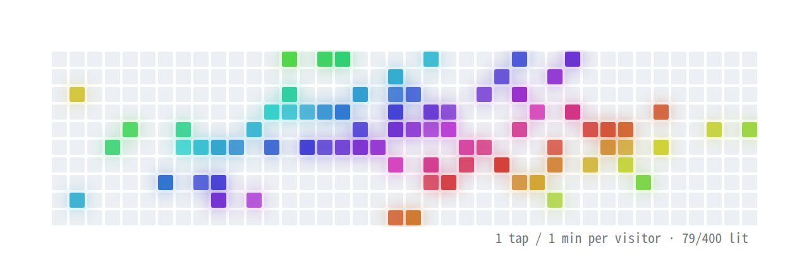
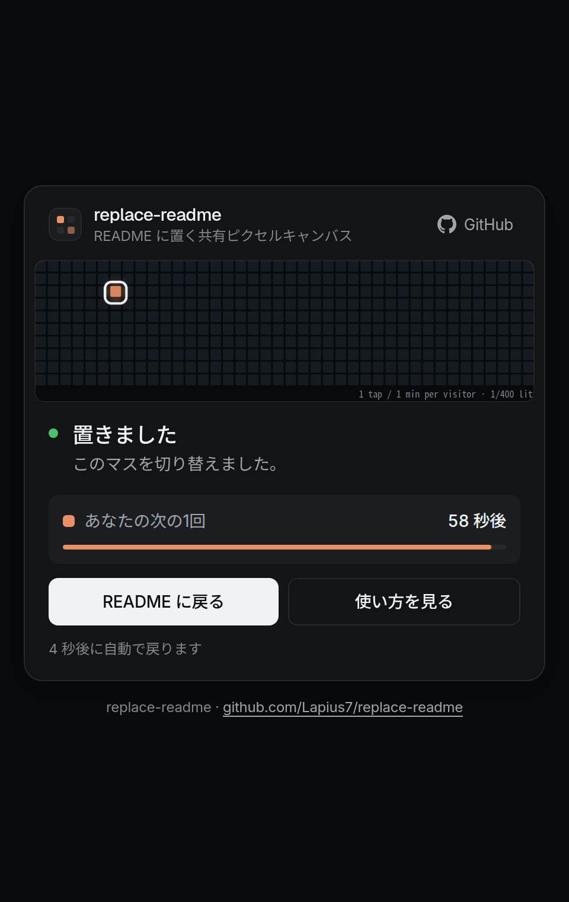
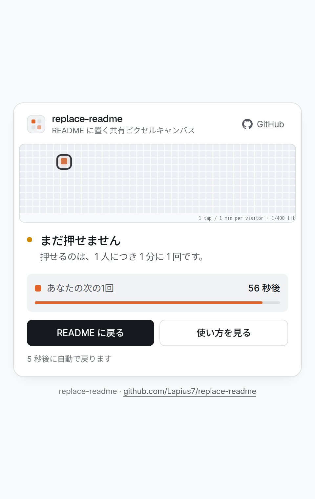
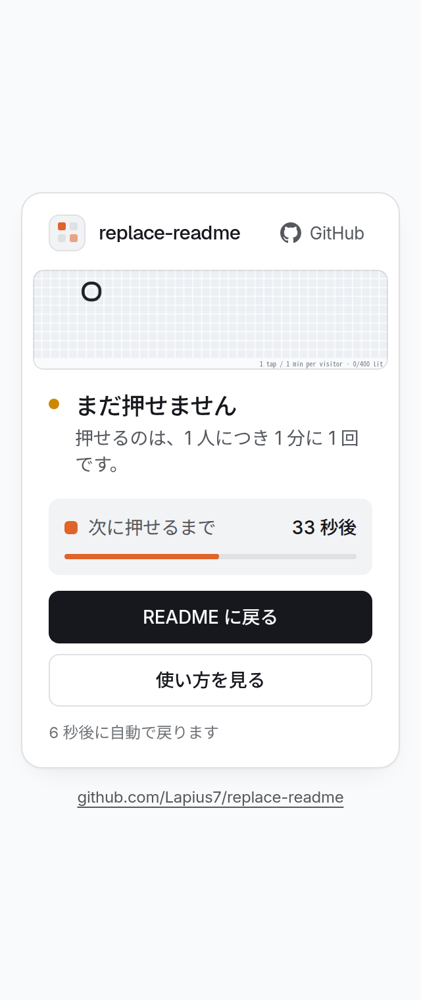

English | [日本語](README.ja.md)

# replace-readme

A shared pixel canvas you can put in a README. Visitors click a square in the image to toggle it, and everyone sees the same board.

<p align="center">
  <picture>
    <source media="(prefers-color-scheme: dark)" srcset="docs/images/board-dark.png">
    
  </picture>
</p>

<p align="center"><sub>Sample data. The live board starts empty.</sub></p>

Live service: https://replace-readme.wks.lapius7.com

It runs on a Cloudflare Worker with a Durable Object (SQLite) as the board store. There is no client script. The whole thing is one `<a>`, one `` and a server that answers both.

## Contents

- [Quick start](#quick-start)
- [URLs](#urls)
- [Grid density](#grid-density)
- [What visitors see](#what-visitors-see)
- [How it works](#how-it-works)
- [Privacy](#privacy)
- [Limitations](#limitations)
- [Self-hosting](#self-hosting)
- [Configuration](#configuration)
- [Credits](#credits)

## Quick start

Paste this into your README. Change `my-board` to any name you like.

```html
<a href="https://replace-readme.wks.lapius7.com/board/my-board/40/press">
  <picture>
    <source media="(prefers-color-scheme: dark)" srcset="https://replace-readme.wks.lapius7.com/board/my-board/40.svg?mode=dark">
    
  </picture>
</a>
```

Keep these three details, or clicks land on the wrong square:

- `ismap` on the ``. It makes the browser append the click position to the link.
- `width="560"` and no `height`. The image is drawn for exactly 560 px.
- The column count (`40` above) must be the same in the image URL and the link URL.

A board is created the first time someone presses it. The name is lower-cased and must match `[a-z0-9][a-z0-9-]{0,38}`.

## URLs

| URL | What it returns |
| --- | --- |
| `/` | 302 redirect to this repository |
| `/board/<name>.svg` | The board as an SVG, default density |
| `/board/<name>/<cols>.svg` | The board with `<cols>` columns |
| `/board/<name>/<cols>/press?x,y` | Toggles the square under the click, then shows a result page |
| `?mode=light` / `?mode=dark` | Theme of the SVG (default `light`) |

Anything else returns an error page with a button to this repository.

## Grid density

`<cols>` sets how many columns the board has. The image is always 560 × 140 px, so the squares stay square and the row count follows from the columns.

| Rule | Value |
| --- | --- |
| Allowed values | multiples of 4, from 8 to 96 |
| Default (no `<cols>`) | 40 |
| Rows | `cols / 4` |
| At 40 columns | 14 px pitch, 10 rows |

The density has to be in the URL path, not the query string. The browser replaces the whole query with the click position (`?x,y`) when it follows an `ismap` link.

## What visitors see

Pressing a square opens a result page. It shows the board with the pressed square ringed, whether the press was counted, and the visitor's own time until the next press. It returns to the README after about six seconds.

<p align="center">
  
  &nbsp;
  
</p>

<p align="center">
  
</p>

The page text is in Japanese.

## How it works

- **Click position.** For `` inside `<a>`, the browser opens the link with `?x,y`, in rendered CSS pixels from the top-left of the image. The server divides by the cell size to get the square.
- **Real clicks only.** `/press` counts a request only when it has `?x,y`, `Sec-Fetch-Mode: navigate` and `Sec-Fetch-Dest: document`. Embedding `/press` as an image or fetching it from a script does nothing.
- **Why a result page.** GitHub serves README images through its camo proxy, so the image request never carries the visitor's IP. The press request comes straight from the browser. The cooldown notice therefore has to be a page, not part of the image.
- **Glow.** Lit squares are drawn twice with `<use>`. The first copy has an `feGaussianBlur` filter. Squares also pulse with SMIL `<animate>`. All of this works inside ``.
- **Colours.** Each visitor gets a hue from a salted SHA-256 of their key, so one person always has the same colour.
- **Cooldown.** One press per visitor per 60 seconds. A row with only the hash and a time is kept for that long.
- **Storage.** One Durable Object per board, with SQLite tables `cells`, `taps` and `meta`.
- **Caching.** Images are sent with `no-cache` so a refresh shows the latest board.

## Privacy

The visitor key is the client IP, with IPv6 grouped by /64. It is hashed with a random salt that is stored with the board. Only the hash is kept, and only until the cooldown ends. The IP address itself is not stored.

## Limitations

- **560 px.** The image must render at exactly 560 px. On narrow windows and phones GitHub scales README images down, and then clicks hit the wrong square.
- **Names are public and unauthenticated.** Anyone who knows a board name can press it, including from another README. Ways to restrict this are a secret path segment, an allowlist of names, or rate limits per board. None is built in.
- **The `demo` board is shared.** It is public and anyone can change it.
- **The cooldown is per visitor key.** People behind the same IP (or IPv6 /64) share a cooldown.

## Self-hosting

You need a Cloudflare account and `pnpm`.

```bash
pnpm install
pnpm typecheck
pnpm dev        # local
pnpm deploy     # wrangler deploy
```

Edit `wrangler.jsonc` first: change `routes` to your own domain and `vars` to your own links. The Durable Object class `Canvas` is created by the `v1` migration.

## Configuration

Set these in `vars` of `wrangler.jsonc`.

| Variable | Default | Meaning |
| --- | --- | --- |
| `GITHUB_URL` | this repository | Target of `/` and of the buttons on error pages |
| `REDIRECT_URL` | `https://github.com/Lapius7` | Where result pages return to (the `demo` board returns to `GITHUB_URL`) |
| `WIDTH` / `HEIGHT` | 560 / 140 | Image size in px |
| `DEFAULT_COLS` | 40 | Columns when the URL has none |
| `MIN_COLS` / `MAX_COLS` | 8 / 96 | Allowed range. The column count must be a multiple of `WIDTH / HEIGHT` |
| `COOLDOWN_MS` | 60000 | Time between presses per visitor |

## Credits

The idea of a clickable shared canvas in a profile README comes from [cnrad/placefile](https://github.com/cnrad/placefile). This project is an independent implementation with its own URL structure, rendering and server code.

## License

MIT. See [LICENSE](LICENSE).
